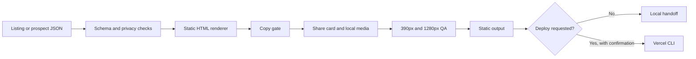

# AI Demo Website Builder

Builds a polished one page local business demo and a per-prospect landing page from structured JSON, then checks the copy, share card, and mobile layout before an optional deploy.

## Why I built it

I wanted a repeatable way to turn public listing facts into a useful sales demo without hand building every page. Most of the work went into keeping every fact traceable to its source, getting the phone layout right, and stopping weak generated copy before a page could ship.

## How it works



- The business renderer uses name, category, address, phone, hours, services, reviews, rating, and photo descriptors from one JSON record.
- Real builds can reference reviewed local JPG, PNG, WebP, or SVG files in each photo entry. The builder copies them into the static output.
- Demo mode creates SVG placeholder art and a 1200 by 630 PNG share card without calling a maps or image API.
- The prospect renderer turns a separate JSON record into a focused page with observations, a recommendation, and one action.
- Browser QA loads the static files directly, captures phone and desktop screenshots, and checks overflow, image alt text, and 44 pixel tap targets.
- If the host blocks browser processes, QA uses an in-process MuPDF render and records that fallback in its report.

## Guardrails

- Demo mode only accepts records marked `fictional`, reserved `555` phone numbers, and `example.com` URLs.
- The copy gate runs before `index.html` is written. It blocks unfilled tokens, long dash characters, explicit call durations, common corporate filler, and common AI writing tells.
- Review text is isolated in `blockquote` elements. That preserves source wording while keeping the authored copy gate focused on text the generator controls.
- Every generated phone number comes from the validated JSON record. The renderer does not keep a second copy of business facts.
- Placeholder media is labeled as fictional in the SVG metadata and on the page.
- Deployment is a separate command. It requires an explicit confirmation flag and validates the project name before invoking the CLI.
- The demo never fetches Google Maps, business photos, or prospect data.

## Quick start

Demo mode needs no API keys:

```bash
python3 -m venv .venv
source .venv/bin/activate
pip install -r requirements.txt
playwright install chromium
python -m demo_builder demo
```

Use Python 3.10 or newer.

Open `out/business/index.html` and `out/prospect/index.html`. QA screenshots and the machine readable report are in `out/qa/`.

To build from your own normalized listing JSON:

```bash
python -m demo_builder build-business \
  --input path/to/business.json \
  --output out/my-business

python -m demo_builder qa \
  --output-root out \
  --sites my-business \
  --qa-dir out/qa-my-business
```

The accepted business and prospect shapes are shown in `fixtures/`. Set `public_url` to the final absolute page URL before building so canonical and share metadata point to the right place.

Optional deploy:

```bash
python -m demo_builder deploy \
  --site-dir out/my-business \
  --project-name your-project-name \
  --confirm-deploy
```

The deploy command uses the locally authenticated Vercel CLI. No token, account ID, team ID, webhook, or project name is stored in this repository.

## Example output

The checked-in demo uses the fictional `Northwind Bakery` listing and the fictional `Jamie Rivera` prospect record for `Northwind Dental`.

- `out/business/` contains the one page site, five generated SVG placeholders, listing snapshot, copy report, and PNG share card.
- `out/prospect/` contains the generated per-prospect page, fixture snapshot, and copy report.
- `out/qa/` contains 390px and 1280px screenshots plus the JSON QA report.

## Tests

```bash
pytest -q
```

The offline suite covers input privacy checks, copy blocking, HTML output, Open Graph metadata, image dimensions, template completion, and deploy confirmation.

## Tech

- Python standard library for validation, templating, local serving, and the command line interface
- Pillow for deterministic PNG share card generation
- Playwright for phone and desktop screenshots plus layout measurements
- PyMuPDF for screenshot fallback in restricted execution environments
- Static HTML, CSS, and JavaScript for deployable output with no front end build step
- Pytest for offline tests

## License

MIT. Copyright (c) 2026 Christian Terrone.
